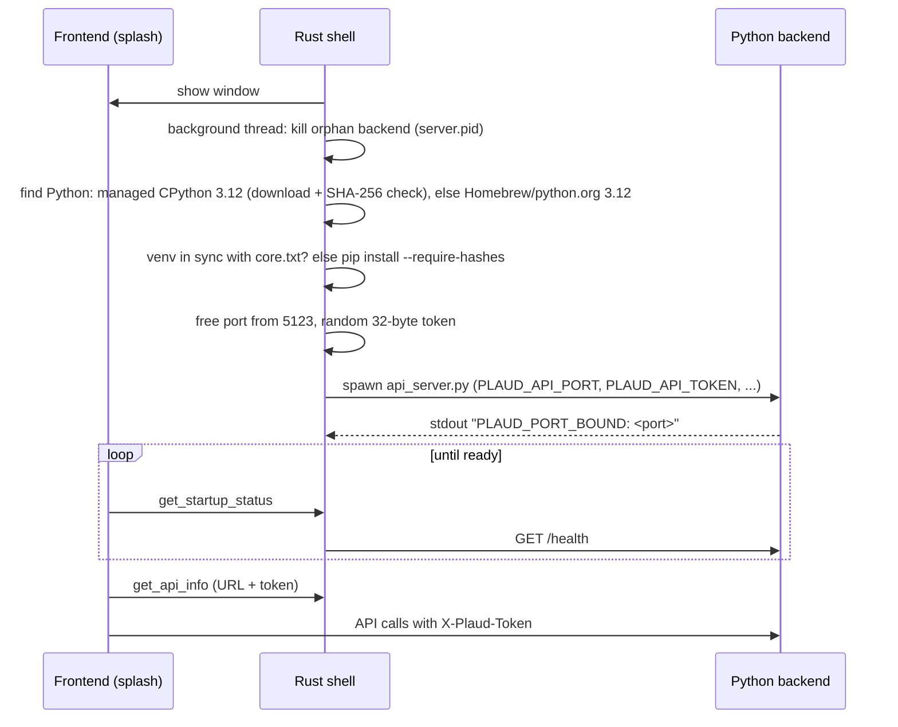
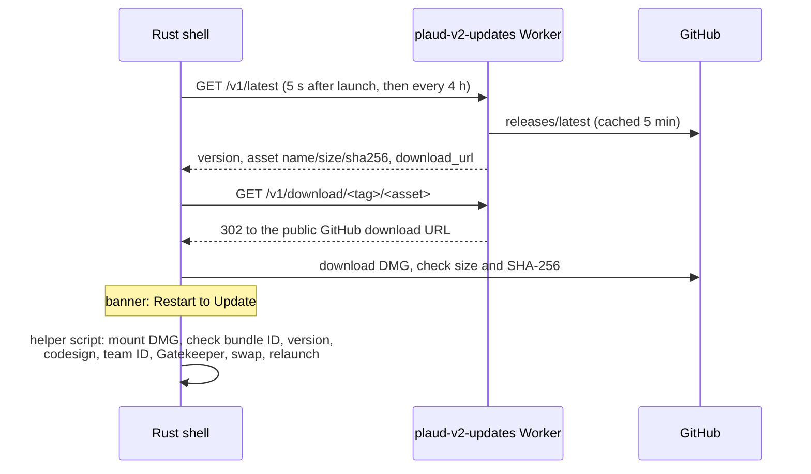

# Architecture

How Open Pin is put together, as of v2.4.0. For running and testing it see
[DEVELOPMENT.md](DEVELOPMENT.md); for shipping it see [RELEASING.md](RELEASING.md).

## Names

The app was called **Plaud V2** until it was renamed **Open Pin** (after v2.5.3). Everything
users see says Open Pin. These internal names keep the old name on purpose, because existing
installs, their data or their permissions depend on them. Don't rename them:

| Legacy name | Where | Why it stays |
|---|---|---|
| `com.plaud.v2` | Bundle ID (`tauri.conf.json`), `Application Support/com.plaud.v2/` (venv, Python, FFmpeg, updates, `diagnostics.log`), `com.plaud.v2.dev` | macOS ties Bluetooth permission, notifications and the Keychain items' access to it; the updater refuses any other ID |
| `Plaud V2`, `Plaud V2 (Dev)` | Data folder `Application Support/Plaud V2/`, logs `Logs/Plaud V2/` (`paths.rs`, `app/utils/constants.py`) | Recordings, settings and tokens live there. Fixed literals, never derived from `productName` |
| `.plaud_v2_config.json`, `.plaud_config.json`, config keys | Data folder | Existing settings |
| `Plaud V2 pairing`, `Plaud V2 (Dev) pairing` | Keychain service names (`app/utils/pairing_store.py`) | Existing pairing backups. Item labels say Open Pin |
| `plaud-v2-pairing` | Pairing export file format (`app/utils/pairing_file.py`) | Older exports import |
| `plaud-v2`, `plaud_v2` | Crate, binary (`Contents/MacOS/plaud-v2`), Python package, log targets (`RUST_LOG=plaud_v2=…`) | Internal only |
| `plaud://` | Deep-link scheme | Plaud's sign-in redirects to it |
| `PLAUD_*` | Environment variables (`PLAUD_DATA_DIR`, `PLAUD_API_TOKEN`…), the `X-Plaud-Token` header | Internal only |
| `plaud-v2-updates` | The update Worker and its `workers.dev` URL (`WORKER_BASE`) | Installed apps call that URL |
| `<!-- plaud-v2-worker -->` | Marker in issues the Worker created | Finds existing issues |
| `Plaud V2 — transcript & summary` | Notion section heading written before the rename | Still recognised, so updates replace old sections in place |

`tests/test_legacy_names.py` and the tests in `paths.rs` and `migrate.rs` pin these. How installs
move from `Plaud V2.app` to `Open Pin.app` is in
[RELEASING.md](RELEASING.md#the-rename-to-open-pin).

## Overview

Three parts in one macOS app bundle:

1. **Rust shell** (`src-tauri/`, Tauri 2.12). Owns the window, tray, dock icon, login item,
   sleep/wake detection, logging, the updater and the bug report export. It sets up and supervises
   the Python backend.
2. **Python backend** (`app/` and `src/`, Flask). Does the real work: Bluetooth, WiFi sync,
   decryption, transcription, summaries, conversation coaching, speaker names, Notion, Google
   Drive, Plaud Cloud, and the `/mcp/v1` routes AI tools use. Listens on `127.0.0.1`, from port
   5123 up.
3. **Frontend** (`app/index.html`, `app/*.js`, `app/ui/*.js`, `app/css/`). Plain HTML, CSS and
   JavaScript in the system WebKit view, no framework or bundler. It calls the backend over HTTP
   and the shell through Tauri commands.

Outside the bundle's window, a small **MCP connector** (`app/mcp/server.py`, standard library only)
runs when Claude Desktop or Claude Code starts it through a launcher script in Application Support.
It talks to the running backend's `/mcp/v1` routes with its own key, and only while AI tool access
is on (see [MCP server and speaker names](#mcp-server-and-speaker-names-appmcp-approutesmcp_apipy-appstatespeakerspy)).

```
┌─────────────────────── Open Pin.app ───────────────────────┐
│ Frontend (WKWebView, tauri://localhost)                    │
│   tauri-bridge.js → window.plaud.*                         │
│      │ invoke()/events                 │ fetch() + token   │
│      ▼                                 ▼                   │
│ Rust shell (src-tauri/src)        Python backend (Flask)   │
│   python.rs: runtime, venv,  ───► app/api_server.py        │
│   spawn, health, restarts         127.0.0.1:5123+          │
│   commands/: updater, reports                              │
└──────┬───────────────────────────────────┬─────────────────┘
       │ HTTPS                             │ BLE, WiFi hotspot, HTTPS
       ▼                                   ▼
 plaud-v2-updates Worker          NotePin S, AI providers, Notion,
 (infra/update-worker) → GitHub   Google Drive, Plaud API, webhooks

 Claude Desktop / Claude Code ─stdio─► open-pin-mcp launcher ─► app/mcp/server.py
                                        ─HTTP + MCP key─► backend /mcp/v1/* (only while open)
```

## Module map

### Rust shell (`src-tauri/src/`)

| File | Responsibility |
|---|---|
| `deep_link.rs` | Plaud sign-in links: the browser's "Continue to desktop" opens `plaud://login?auth_code=…` (scheme registered via `plugins.deep-link` in `tauri.conf.json`). The decoded code is held until the page takes it (`has_pending_sign_in_code`, `take_pending_sign_in_code`) after a `plaud-sign-in-link` event or at page load; `tauri-bridge.js` waits for the backend, then hands it to the `oauth-callback` listeners. The code is never logged. Any web page can open such a link, so the backend only exchanges a link's code while a sign-in started in the app in the last 15 minutes is pending, using that sign-in's id, which is cleared once used (`exchange_token(from_link=True)` in `app/state/cloud.py`) |
| `lib.rs` | Tauri builder: plugins (opener, single-instance, autostart, notification, dialog, deep-link), tray menu, themed dock icon and system-theme watcher, hide-on-close, the update-check loop, IPC command list, exit handling |
| `lifecycle.rs` | Starts the backend on a background thread; startup status for the splash (`get_startup_status`, `retry_startup`); shutdown (BLE disconnect, then SIGTERM/SIGKILL) once, off the main thread; SIGTERM/SIGINT handling; the panic hook |
| `python.rs` | Managed Python runtime and venv, lockfiles, port choice, per-launch API token, spawning `api_server.py`, `/health` polling, crash restarts (up to 3), orphan cleanup via a PID file |
| `power.rs` | Sleep/wake: `NSWorkspace` notifications, plus a wall-clock fallback; sends one `system-wake` event per wake |
| `paths.rs` | Where everything lives on disk: the data folder passed to Python as `PLAUD_DATA_DIR`, Application Support and log folders, and the separate dev-build folders. All fixed literals with the legacy name (see [Names](#names)) |
| `migrate.rs` | The rename to Open Pin: renames a `Plaud V2.app` bundle to `Open Pin.app` on its first launch, and moves the "Open at login" LaunchAgent to the new name |
| `logging.rs` | `~/Library/Logs/Plaud V2/app.log` (rotates at 1 MB, one old file kept). Backend stdout/stderr lands here too. `RUST_LOG` overrides levels |
| `commands/mod.rs` | IPC commands: API info, theme, login item, dock visibility, folder picker, notifications, the updater, error logging, the bug report export (`export_bug_report`, `reveal_in_finder`) and the diagnostics log |
| `commands/report_scrub.rs` | Removes secrets and personal data from exported bug reports |

### Python backend

| Path | Responsibility |
|---|---|
| `app/api_server.py` | Flask app, request security (below), blueprint registration, startup housekeeping (partial files, WiFi recovery, Notion queue), port binding |
| `app/routes/` | HTTP endpoints, one blueprint per area: `core` (`/health`, `/audio`), `device` (`/device/*`: scan, connect, sync, WiFi sync, record, find-my, depair), `recordings` (list, tag, rename, crop, move, delete, re-download, transcripts), `transcribe` (`/transcribe`, `/summarize`, `/validate-key`), `notion` (`/notion/*`), `gdrive` (`/gdrive/*`), `cloud` (`/cloud/*`), `settings` (including the AI tools switch and the one-click Claude setup, `/mcp/setup/*`), `coaching`, `mcp_api` (`/mcp/v1/*`, the MCP key only), `diagnostics` (`/diagnostics`: checks for a bug report, no secrets) |
| `app/state/` | Long-lived state and logic: `device.py` (BLE connection, handshake, encrypted command channel, file download, WiFi-sync orchestration), `notion.py` (Notion OAuth and MCP session), `gdrive.py` (Drive OAuth and uploads), `cloud.py` (Plaud account and cloud sync), `speakers.py` (speaker names: set, clear, list people, participants) |
| `app/mcp/` | AI tool access ([below](#mcp-server-and-speaker-names-appmcp-approutesmcp_apipy-appstatespeakerspy)): `access.py` (MCP key, connection file, launcher), `server.py` (the stdio connector, standard library only), `library.py` (what the `/mcp/v1` reads return), `clients.py` (editing Claude Desktop and Claude Code settings files) |
| `app/providers/` | AI: `transcribe.py` (Deepgram, Groq, OpenAI), `summarize.py` (summary cascade), `validate.py` (API key checks), `_models.py` (every model ID in one place) |
| `app/utils/` | `config.py` (atomic, locked config), `constants.py` (paths, UUIDs, endpoints), `paths.py` (session-ID validation), `audio.py` (decryption, Ogg wrapping), `wifi_sync_worker.py` (WiFi sync subprocess), `notion_queue.py`, `trash.py`, `redownload_backup.py`, `transcript_locks.py`, `parent_watch.py`, `system.py` (on-demand pip installs, FFmpeg), `webhooks.py`, `recording_utils.py`, `speaker_names.py` (name rules, applying names to text), `tags.py` (tag rules and single-tag add and remove), `changes.py` (the library change counter) |
| `app/requirements/` | Hash-pinned lockfiles: `core.txt` plus the `whisper`, `diarize` and `local-summary` extras. Generated by `scripts/lock-python-deps.sh` |
| `src/` | Older shared modules: `crypto.py` (RSA key loading and decryption for the handshake), `scanner.py` (BLE advertisement parsing), `transcribe.py` (local Whisper and diarization). `tauri.conf.json` bundles these files by name |

### Frontend

`index.html` loads plain scripts in this order: `tauri-bridge.js`, `ui/health-gate.js`,
`ui/utils.js`, `ui/recordings.js`, `ui/transcript.js`, `ui/settings.js`, `ui/setup.js`,
`renderer.js`. They share **one global scope**: two files can't declare the same top-level name
(v2.1.5 shipped a duplicate `const` and the whole UI failed to load).

| File | Responsibility |
|---|---|
| `tauri-bridge.js` | `window.plaud.*`: HTTP calls to the backend (with the token) and Tauri `invoke`/`listen`; error capture for the local diagnostics log, with a simplified copy of the Rust scrubbing rules |
| `ui/health-gate.js` | Startup splash: polls `get_startup_status`, shows progress, errors, **Retry** and the diagnostics log |
| `ui/utils.js` | Shared `app` state and `dom` references, formatters, toasts, Markdown rendering |
| `ui/recordings.js` | Recording list, search, multi-select, bulk actions, delete dialog |
| `ui/transcript.js` | Transcript and summary view, audio player, crop editor, tags |
| `ui/settings.js` | All settings tabs |
| `ui/mcp-settings.js` | Settings › General › AI tools (switch, Connect and Disconnect for Claude Desktop and Claude Code) and the library change poll |
| `ui/setup.js` | First-run onboarding: Plaud sign-in, Bluetooth permission, scan, pair, profile |
| `renderer.js` | Start-up, sync buttons and progress, polling, WiFi-sync UI, wake handling, updates banner |

CSS lives in `app/css/` (`tokens.css` holds the design tokens; light and dark themes), imported
by `app/styles.css`.

## Startup

The window is shown first; Python is set up on a background thread while the splash shows
progress.



Details:

- **Runtime.** `python.rs` downloads a pinned python-build-standalone CPython **3.12.16**
  (`aarch64` only) into `~/Library/Application Support/com.plaud.v2/python/` and checks it against
  a SHA-256 compiled into the app. If that fails it accepts only a CPython 3.12 from Homebrew or
  python.org, because the lockfiles hold cp312 wheels. Intel Macs get a clear error.
- **Venv.** `~/Library/Application Support/com.plaud.v2/venv/`, built from `core.txt` (embedded in
  the binary and written to `.../com.plaud.v2/requirements/`). A stamp file records the
  lockfile's SHA-256, so a release that changes `core.txt` re-syncs the venv on next launch. Each
  launch also checks the core imports and repairs a damaged venv.
- **Extras** (`whisper`, `diarize`, `local-summary`) are installed on first use by
  `app/utils/system.py ensure_installed(..., extra=...)`, constrained by `core.txt`.
- **Readiness.** The backend has 30 s to answer `/health` (120 s right after a fresh download or
  venv sync). After that the splash shows a timeout, but polling continues and a late start still
  becomes ready.
- **Crashes.** The monitor restarts a crashed backend up to 3 times with the same port and token.
  `app/utils/parent_watch.py` makes Python exit if the shell dies.
- **Python startup** (`api_server.py __main__`): remove `*.partial` files, recover recording
  metadata, load the Plaud token, start the Notion queue worker, bind the port (trying up to 8),
  then run WiFi recovery in the background.
- **Shutdown.** Tray **Quit**, Cmd+Q, logout and SIGTERM all stop the backend once: BLE
  disconnect, then SIGTERM, then SIGKILL.

Environment variables passed to Python: `PLAUD_API_PORT`, `PLAUD_API_TOKEN`,
`PLAUD_REQUIREMENTS_DIR`, `PLAUD_PYTHON_RUNTIME`, `PLAUD_APP_VERSION` and `PLAUD_DATA_DIR` (the
data folder: the shell's own `PLAUD_DATA_DIR` if set, else `Plaud V2`, or `Plaud V2 (Dev)` in a
debug build; see Data locations).

## Security model

The backend listens on `127.0.0.1`, which any web page in any browser on the Mac can reach. Three
checks in `app/api_server.py` keep other pages and processes out:

1. **Per-launch token.** The shell generates 32 random bytes per launch and passes them to Python.
   Every request must send them in `X-Plaud-Token`. Only `GET /audio/...` (an `<audio src>` can't
   set headers) and `POST /device/disconnect` (sent with `sendBeacon` on reload) may use
   `?token=` instead. `/health` and CORS preflights are exempt. `/mcp/v1/*` is the exception: it takes the MCP key and
   nothing else (see [MCP server and speaker names](#mcp-server-and-speaker-names-appmcp-approutesmcp_apipy-appstatespeakerspy)).
2. **CORS.** Only `tauri://localhost`, `http://tauri.localhost` and `https://tauri.localhost` get
   CORS headers, so other origins can't read responses or send the token header.
3. **Host check.** Requests whose `Host` isn't `127.0.0.1` or `localhost` are refused, which
   blocks DNS rebinding.

Other rules:

- **Session IDs and paths** from requests are validated (`app/utils/paths.py`) and checked to stay
  inside the recordings folders before use. `/transcribe` only accepts files in those folders.
- **Deletes** go to the macOS Trash (`app/utils/trash.py`), or to `.trash/` in the data folder if
  that fails.
- **Re-download** moves the existing files to `.redownload_backup/<id>/` first and puts them back
  if the device no longer has the recording.
- **Config writes** are atomic, keep a `.bak` copy, are mode `0600`, and go through
  `update_config()` so concurrent writers don't lose each other's changes.
- **WiFi-sync credentials** (bind token, serial signature) go to the worker on stdin, not in
  `argv`, so `ps` can't see them.
- **No secrets in the app or repo.** The updater talks to a Cloudflare Worker that holds the
  GitHub token. See [SECURITY.md](../SECURITY.md).
- The webview CSP (`tauri.conf.json`) only allows connections to the app itself and `127.0.0.1`.

## Data locations

| Path | Contents |
|---|---|
| `~/Library/Application Support/Plaud V2/` | User data (the packaged app's `DATA_DIR`): `recordings/`, `transcripts/`, `.plaud_v2_config.json` (settings, API keys, device tokens, recording metadata), `.plaud_config.json` (Plaud token), `.notion_mcp.json`, `.notion_queue.json`, `.notion_legacy_cache.json`, `.gdrive_config.json`, `coaching/` (see below), `people/` (voices, see "People and voices"), `.hf_token` (optional), `wifi_restore.json`, `wifi_sync.lock`, `wifi_sync.log`, `.trash/`, `.redownload_backup/`, `mcp-connection.json` (only while AI tool access is on) |
| `~/Library/Application Support/com.plaud.v2/` | Shell-managed: `python/`, `venv/`, `requirements/`, `bin/ffmpeg`, `updates/`, `server.pid`, `tauri-prefs.json` (dock visibility), `diagnostics.log`, `mcp/open-pin-mcp` (the launcher for AI tools, written while AI tool access is on) |
| `~/Library/Logs/Plaud V2/` | `app.log`, `update.log` |
| `... Plaud V2 (Dev)/`, `com.plaud.v2.dev/`, `Logs/Plaud V2 (Dev)/` | The same, for debug builds (`tauri dev`). They share only `com.plaud.v2/python/` and `bin/` with the installed app |
| `~/.cache/whisper/`, `~/.cache/huggingface/`, `~/.wespeaker/` | Local Whisper, pyannote and DistilBART models, and the `diarize` package's WeSpeaker model (library defaults) |

`DATA_DIR` is chosen in `app/utils/constants.py`: `PLAUD_DATA_DIR` if set, else
`~/Library/Application Support/Plaud V2/`. The shell always sets `PLAUD_DATA_DIR`
(`src-tauri/src/paths.rs`): the variable it was started with, if any, else `Plaud V2`, or
`Plaud V2 (Dev)` for a debug build, and reads `wifi_sync.log` from that same folder for bug
reports. The repo is never used as the data folder. Users can also pick another
recordings folder; old folders stay listed.

## Device sync

The protocol is documented in [reverse-engineering/PROTOCOL.md](reverse-engineering/PROTOCOL.md) and
[reverse-engineering/COMMANDS.md](reverse-engineering/COMMANDS.md). In short:

### Bluetooth (`app/state/device.py`)

1. Scan with bleak and identify devices by the serial number in the manufacturer data (macOS
   randomises BLE addresses).
2. Send the serial-number signature, send the app's RSA public key, RSA-decrypt the device's
   reply to get the ChaCha20-Poly1305 session key, nonce and AAD, and check it decrypts
   `PLAUD.AI`.
3. Send the **BIND_TOKEN** handshake (cmd 1, twice: flag 0 then 1). The token is per device and
   comes from Plaud's API at pairing; the static APP_KEY from older notes doesn't work.
4. Sync time, read state, storage and battery, list files.
5. Download each new file. With the expected size and a clean end-of-file marker it's saved. A
   clean end with a different size is kept only if it decrypts. Anything else (stall, abort,
   disconnect, no end marker) is kept as `{id}_partial.bin` and retried next sync.
6. Decrypt (`app/utils/audio.py`): RSA-decrypt the per-file key, XOR each 80-byte Opus frame with
   a ChaCha20 keystream, check the result looks like Opus, wrap it in Ogg. A file that fails the
   check raises an error instead of saving noise.
7. Optionally delete the file from the device, only after an exact, clean download.

Progress counts only the recordings this Mac is missing, not every file on the device. The sync
first works out which files it will download and their total size, reports "2 new recordings to
sync (5.4 MB)", then "Syncing recording 1 of 2 · 1.2 MB of 5.4 MB", with the percentage following
the bytes received (`app/utils/sync_progress.py`; `/device/sync-status` also returns
`file_index`, `file_count`, `bytes_done` and `bytes_total`). The bar is the download only:
transcription runs afterwards in the background with its own badges.

### WiFi (`app/utils/wifi_sync_worker.py`)

Used for large files (or on request). It runs as a separate process with its own BLE session,
because the device drops crypto sessions when BLE reconnects.

1. BLE handshake, then ask the device to open its hotspot.
2. Write a restore record (`wifi_restore.json`, fsynced) before changing any network setting.
3. Join the hotspot directly with CoreWLAN. Saved networks are left alone by default; they are
   paused only if macOS keeps auto-joining away, and only if each can be put back exactly.
4. The device connects to a WebSocket server the worker opens on the Mac; files are transferred
   encrypted with the BLE session keys.
5. Restore: rejoin the original network, re-add any paused networks in their original order,
   forget the hotspot. The record is deleted only after a verified restore.

Progress uses the same wording as Bluetooth (`app/utils/sync_progress.py`): the transfer fills
35-90% of the Wi-Fi sync, moving with each chunk (at most every 0.5 s), and the budget report
repeats the current line rather than resetting it.

A lock file (`wifi_sync.lock`) allows one worker at a time. If the app crashes mid-sync, the next
launch replays the restore record. A restore that keeps failing is given up after a few tries
(record moved to `wifi_restore.stuck.json`) and the UI says once which networks are missing.

## AI pipeline

### Transcription (`app/routes/transcribe.py`, `app/providers/transcribe.py`)

The provider chosen in Settings goes first, then the other cloud providers that have keys:

| Provider | Model | Notes |
|---|---|---|
| Deepgram | `nova-3` | Default. Speaker labels; custom vocabulary as keywords |
| Groq | `whisper-large-v3` | Vocabulary and profile as the prompt |
| OpenAI | `gpt-transcribe` | Text only, so segment times are estimated |
| Local | openai-whisper `base`/`small`/`medium`/`turbo`/`large` | Chosen in Settings, or used when no cloud provider works |

The result is saved as `transcripts/<id>.json` plus a `.txt`; spoken tags at the start of a
recording are detected and applied. Webhooks fire on `transcribe` (after the background speaker
labels, when those run).

Speaker labels follow the transcription provider; there's no separate setting beyond the
on/off toggle. Deepgram returns them with its transcript. For Groq, OpenAI or a Deepgram failure,
`_background_diarize` (`app/routes/transcribe.py`) labels the cloud transcript on the Mac after
the response; local Whisper does it inline. Local diarization (`src/transcribe.py`) tries:

1. The `diarize` package (Silero VAD + WeSpeaker ONNX, CPU). No token. The pinned `diarize` extra
   is installed on first use; a failed install isn't retried for 30 minutes. Its torchaudio 2.11
   needs torchcodec to decode audio, which the extra doesn't include, so `torchaudio.load` is
   routed through soundfile, and the audio is converted to 16 kHz mono WAV with FFmpeg first.
2. pyannote (`pyannote/speaker-diarization-3.1`), only if tier 1 couldn't run, a Hugging Face
   token is saved and pyannote.audio is already installed. The app never installs pyannote (it
   isn't in the lockfiles). The token is set in Settings › Processing › Speaker Identification:
   `POST /settings {hf_token}` checks it against `huggingface.co/api/whoami-v2`, then writes
   `.hf_token` (mode 0600). `GET /settings` returns only `hf_token_set`. The user must also accept
   the terms of `pyannote/speaker-diarization-3.1` and `pyannote/segmentation-3.0`.

The transcript JSON records `diarization_status` (`running`, `done`, `none` or `failed`) and a
`diarization_message`. The frontend polls `/transcripts` while it's `running` and shows the
message when it ends.

### Summaries (`app/providers/summarize.py`)

All model IDs are in `app/providers/_models.py`. The order is:

1. Anthropic `claude-sonnet-5-5` (or OpenRouter `anthropic/claude-sonnet-5.5` if there's no
   Anthropic key)
2. OpenAI `gpt-6.1-sol` (or OpenRouter `openai/gpt-6.1-sol` if there's no OpenAI key)
3. Ollama, if running locally, with the best model already pulled (`qwen3.8`, `qwen3.6`, `qwen3.5`, `gemma4`, ...; never a `-cloud` tag)
4. DistilBART (`sshleifer/distilbart-cnn-12-6`), installed on demand

The provider group chosen in Settings goes first. LLMs get the transcript as `[mm:ss] Speaker:
text` lines with the user's profile and tags as context, and return JSON with a summary and a
title (if a provider gives none, the first sentence of the summary is used). Webhooks fire on `summarize`, and
Notion auto-push runs if enabled.

**Titles without a summary** (`generate_title`, called by `/transcribe` through `_auto_title`): when
auto-summarise is off and the recording has no name yet, a short title-only call names it (Claude
`claude-haiku-5-5`, else OpenAI or OpenRouter, else Ollama; nothing leaves the Mac when the summary
provider is Local). It's stored as `auto_title` with `auto_title_source: "transcript"`, so a later
summary's title replaces it, unless the user renamed the recording in between.

## Conversation coaching (`app/coaching/`, `app/routes/coaching.py`)

Coaching tells the owner how they came across in a conversation and tracks it over weeks. The
design is in [superpowers/specs/2026-11-04-conversation-coaching-design.md](superpowers/specs/2026-11-04-conversation-coaching-design.md).

### Data flow

1. **Capture.** Deepgram is asked for `filler_words=true` and its per-word timing and speakers are
   kept (`app/providers/transcribe.py`). The clean transcript is built from the same words with
   filler tokens ("um", "uh", "er" and their spellings; "hmm", "mm" and "mhm" stay) dropped, and
   a dropped filler's full stop or question mark handed to the word before it. A recording with
   no fillers keeps Deepgram's own text exactly. The unfiltered words are returned separately and
   saved to the recording's words file by `_save_coaching_words` (`app/routes/transcribe.py`). Groq, OpenAI and local Whisper have no verbatim words, so they
   save an empty list and their metrics fall back to segment estimates.
2. **Hook.** Once transcription and speaker labels are final, `_after_transcript_final` starts
   `start_coaching_async` (`app/coaching/runner.py`) next to each `fire_webhooks("transcribe", ...)`
   call: the end of `_background_diarize` and the branches that skip it. It runs on a daemon
   thread, like diarization.
3. **Owner.** `voice.py` matches each speaker's audio against the owner's voice profile with
   WeSpeaker embeddings. A confident match marks the owner (a set of labels, since a wearable mic
   can split one person into two). Otherwise the status is `needs_owner` and nothing is analysed
   until the user picks. A pick or correction (`POST /coaching/<id>/owner`) is saved together with
   status `running` before the response, then the recording is coached again in the background.
   The pick updates the voice profile only when the WeSpeaker model is already installed (and the
   audio is on the Mac); otherwise it is used for this recording only.
4. **Metrics.** `metrics.py` is pure computation over the words or segments: pace, talk share,
   longest monologue, likely interruptions (made and received), patience, questions, filler words
   and interactivity. Each value records whether it is exact, estimated or unavailable.
   `targets.py` holds every target range and tunable number.
5. **Review.** `review.py` makes one structured-output call through `call_llm_json`
   (`app/providers/llm_json.py`), which uses the summary provider preference and cascade
   (Anthropic, OpenAI, OpenRouter, Ollama; no DistilBART, which can't follow a schema). With Local
   (or Ollama) as the summary provider only Ollama is tried, never a cloud key; if Ollama isn't
   running or has no chat model the report shows the measured metrics only, and any other error
   is a failure. It returns scores (each citing the times it is based on), a summary, next-time
   actions, reactions and notable moments. `ground` drops anything that cites a timestamp not in
   the transcript, and any score left without a real time. Only the owner's likely interruptions
   are put to the model for confirmation. With `coaching_ai_review` off the runner never calls
   `review_conversation` (no provider is contacted, for automatic and forced runs alike) and the
   run ends `done` with the metrics, no review and `status_reason` "AI review is off".
6. **Progress.** `progress.py` aggregates finished sidecars into per-week series, a rolling
   baseline, the most improved and most stuck habit, and a weekly focus. Recordings flagged as
   "speakers mixed up", and excluded ones, are left out. A report without a review still counts
   for the metrics; it just has no overall score.

### Engagement and laughter (`laughter.py`, `engagement.py`)

A measured Engagement score (0-100), separate from the AI scores, from three parts. The design is
in [superpowers/specs/2026-11-05-engagement-design.md](superpowers/specs/2026-11-05-engagement-design.md).

- **Laughs after your lines.** `laughter.py` runs the CED-Tiny audio classifier (ONNX, Apache-2.0)
  on the Mac with onnxruntime and numpy from the `diarize` extra (imported lazily; no new
  dependency). The model is downloaded on first need from Hugging Face at a pinned revision to
  `models/ced-tiny.onnx` in the app's support folder, and kept only if its size and SHA-256 match.
  After a failed download, none is tried again in that process for an hour, so queued runs don't
  each wait out a stalled download. Inference uses up to 4 threads, which sleep rather than spin
  between batches. Audio is read in chunks as 16 kHz mono, scored in 2 s windows every 0.5 s, and
  merged into laughter events; events over 8 s (TV, a crowd) are dropped. `engagement.py` counts
  an event that starts within 2 s after one of your lines (a transcript segment, not a merged
  turn, since a laugh between two of your lines has no segment of its own), or overlaps its last
  second, unless it is about as loud as your own speech (then it is probably your laugh). At most
  one per line.
  The loudness check doesn't use the detector's own loudness: its 2 s windows reach back into your
  last words, so a laugh straight after you would look as loud as you. Instead `measure_loudness`
  measures each candidate again from the audio, from 0.5 s before the laugh (but never before your
  line ends) to 0.5 s after it, cut at your next line, as the loudest 25 ms frame's RMS. Your level
  is the median of the same measure over your lines. A laugh within 3 dB of your level, or louder,
  isn't counted, and nor is one with under 0.25 s left to measure. The audio is converted once:
  the runner calls `laughter.detect(audio, keep_wav=True)`, measures from the detector's 16 kHz
  WAV, reading in chunks, and then deletes it.
- **Follow-up questions to you.** The next speaker's turn straight after yours, with a `?` in its
  first 30 words. Your turns under three words don't count.
- **Points others built on.** From the AI review's reactions (engaged or a follow-up), so only
  with the review on.

Each part maps to 0-100 against its target in `targets.py` (laughs per hour, follow-up share,
built-on share), and the score is the mean of the parts available. A part that couldn't be
measured (no model, too few turns or reactions, the review off) is left out, never counted as 0.
When laughter can't be checked, the block says why: "No audio on this Mac", "Too long to check
for laughter" (over 3 hours, skipped before any conversion), "Laughter detection didn't run" (it
failed), "Couldn't download the laughter model", or "Couldn't measure your voice level, so laughs
can't be told apart from yours" (your voice level couldn't be measured). Engagement never fails a
run: if any step of it breaks, the runner falls back to laughter "unavailable" with every other
part still worked out, and the metrics and review are kept whatever happens. The runner detects laughter before the review, so the
review's prompt lists the laughs (and charisma may use them; laugh times are valid evidence for
`ground`, within 1 s since the prompt shows them as `[mm:ss]`, while line starts keep 2 s), and
computes engagement after it. It stores `sidecar["engagement"]` and copies the three
parts into `metrics.owner`, so Progress tracks them like the other measures; `engagement_score` is
one more Progress series, kept out of `overall_score`. Laughs per hour is a series but never the
focus or "still stuck", because the detector misses soft chuckles and isn't calibrated on real
recordings yet.

### Sidecar and status

Each recording has `DATA_DIR/coaching/<session_id>.json` (`store.py`) holding the owner, metrics,
review and `status`: `running`, `done`, `needs_owner`, `skipped` (one speaker, no speaker labels,
or under two minutes), `failed` or `excluded`. The verbatim words live next to it in
`DATA_DIR/coaching/<session_id>.words.json`, so loading a sidecar never carries them and no route
returns them (an older sidecar that still holds `words` inline is read by the runner and stripped
by the routes). The transcript JSON is not touched. Writes to both files are atomic and serialised
under one per-recording lock, separate from the transcript lock, because `_merge_transcript`
holds that one and it isn't reentrant.

A re-transcribe or transcript edit that changes the text calls `mark_stale` after the transcript
lock is released, which sets `report_stale` the way `summary_stale` works. New speaker labels from
background diarization leave the text unchanged, so they don't call `mark_stale`: the coaching
hook that runs when diarization finishes coaches the recording again (when `coaching_auto` is on),
and a saved owner is reused only while the speaker labelling it was made for is unchanged.

"Don't coach this recording" (`runner.set_excluded`, `POST /coaching/<id>/exclude`) sets
`excluded: true` and status `excluded` and deletes the report (metrics, review, owner pick,
candidates, the mixed-up flag); the words file stays, as it belongs to the transcription. It
also bumps the run number and drops any queued rerun, and a run's commit drops its result if the
sidecar is excluded by then, so a run in flight can't bring the report back. While excluded no run
starts (`start_coaching_async` and `_run_once` check, even when forced), owner picks and voice
setup refuse the recording (409), so the voice profile never learns from it, and progress
skips it. Re-transcribing keeps it: `mark_stale` and `save_words` leave the flag alone. "Coach this
recording" clears it (`{"exclude": false}`) and then runs `/run`.

Reports saved before a new section existed (Engagement, v2.9.0) gain it by being coached again.
"Coach again" on any finished report is `/run` (forced: the saved owner is kept and the voice
profile isn't taught; only an owner pick teaches it). "Coach them again" in Progress
(`runner.start_rerun_all`) coaches every recording whose sidecar is `done`, has no `engagement`,
isn't excluded and has a transcript: one at a time on one daemon thread, each through
`run_coaching(sid, None, force=True)`, so the run locks, run numbers, stale checks and
`coaching_ai_review` apply as for one recording. Each is checked again just before its turn, a
failure on one doesn't stop the rest, only one bulk run goes at a time, and cancelling stops it
after the recording in progress. Coaching a `done` report again never costs it its AI review: if
the new review fails (provider error, bad key, Ollama not running), the run saves the new metrics
and engagement but keeps the previous review and status `done`, with `REVIEW_KEPT` as the reason
(the tab shows it as a quiet note), as long as that review was made for the same transcript and
owner; otherwise the run fails as usual. It keeps going when Progress closes; the state lives only in the
process, so quitting the app ends it (the recordings not reached still count as pending).

Deleting a recording (`/recordings/delete`) or its transcript (`/transcripts/delete`) moves its
sidecar and words file to the Trash with the transcript, and `/coaching/progress` skips any
sidecar whose transcript is gone. The owner's voice profile is
`DATA_DIR/coaching/voice_profile.json` (mode `0600`); it and the words files are never treated as
session ids by the routes.

### Routes

| Route | Purpose |
|---|---|
| `GET /coaching/<id>` | Sidecar status and report |
| `POST /coaching/<id>/run` | Coach this recording (old or skipped ones) |
| `POST /coaching/<id>/owner` | Choose or correct which speakers are the owner |
| `POST /coaching/<id>/mixed-up` | Flag or unflag "speakers mixed up" |
| `POST /coaching/<id>/exclude` | "Don't coach this recording" (`{"exclude": true}`) or undo it (`false`) |
| `GET /coaching/progress` | Aggregated progress |
| `GET /coaching/rerun-all` | Older reports without Engagement (`pending_count`) and the bulk run's `running`, `done`, `total`, `current` |
| `POST /coaching/rerun-all` | Coach them again, one at a time (409 if a bulk run is already going) |
| `POST /coaching/rerun-all/cancel` | Stop the bulk run after the recording in progress |
| `GET`/`DELETE /coaching/voice` | Voice profile status, remove it |
| `POST /coaching/voice/install` | Install the WeSpeaker model (the `diarize` extra) |
| `POST /coaching/voice/setup` | Build the profile from a speaker in a past recording |

### Settings and speaker labels

`coaching_auto` (default on) starts coaching automatically. It has two switches showing the same
value: "Coach my conversations automatically" in Transcription & AI › Your voice & coaching and
"Coach my conversations" in Automation › New recordings, between transcribe and summarise. Unlike
summarising, it isn't tied to the steps before it: coaching follows any transcription, including one
the user starts, so the row stays usable with them off and a hint says so. Coaching needs speaker labels, so a one-time
migration turns `diarize` on for installs where it is off, and turning `diarize` off turns
`coaching_auto` off; both switches then say "Needs speaker labels". `coaching_ai_review` (default
on, "Include an AI review") decides whether the review runs at all; it is a privacy choice, so it
applies to "Coach this recording" too. Deepgram users haven't installed the WeSpeaker model, because Deepgram supplies
the labels, so it is installed during voice setup, with progress and an error message, never
silently.

### Frontend

A Coaching tab in the recording view, a Progress view opened from a header button, and a "Your
voice & coaching" section in Settings › Transcription & AI. Charts are hand-rolled SVG. The tab's
Engagement section follows the measures: the score marked "measured", then each part with time
chips that play from that moment (a laugh's chip starts a few seconds before it, so you hear your
line too), the reason when laughter couldn't be checked, and one note that quiet chuckles can be
missed. In Progress the Engagement score sits after the Overall score and its parts after the
other measures; each row shows only when its series has data. Every
state of the tab but an excluded one ends with "Don't coach this recording", which asks first
(`showConfirmDialog`); a finished report also has a quiet "Coach again" beside it. An excluded
recording shows "This recording isn't coached." with "Coach this recording". When older reports
lack Engagement, Progress says how many with "Coach them again", which asks first (saying how many
AI calls that is, about one per report, with the AI review on), then shows "Coaching again: k of N"
with Stop, polls every 3 s while open (a failed poll keeps the last status and polls again) and
reloads the progress when the run ends.

### Privacy

Voice embeddings and verbatim words stay in `DATA_DIR` and are never sent anywhere. Laughter is
detected on the Mac; the only download is the model itself, from Hugging Face, checked by size and
SHA-256. The only call that sends anything is the review, which sends transcript text and metrics
(and the times and lines of the laughs) to the provider the user chose
for summaries (never an Ollama `-cloud` model). With `coaching_ai_review` off it is never made. See [SECURITY.md](../SECURITY.md).

## MCP server and speaker names (`app/mcp/`, `app/routes/mcp_api.py`, `app/state/speakers.py`)

Claude Desktop and Claude Code can use the library as material for other work: find a recording,
read what was said, name speakers, tag. Open Pin stays a data source. It makes no new AI calls
because of this.

### Flow

```
Claude Desktop / Claude Code
  | starts (stdio)
  v
launcher   ~/Library/Application Support/com.plaud.v2/mcp/open-pin-mcp   (com.plaud.v2.dev for debug builds and a backend run from a checkout)
  | runs the managed venv's Python on the connector in the current app bundle
  v
connector  app/mcp/server.py   (MCP over stdio, standard library only, no state)
  | reads mcp-connection.json: port + MCP key
  | HTTP to 127.0.0.1:<port>/mcp/v1/*, header X-Open-Pin-MCP-Key
  v
backend    app/routes/mcp_api.py -> the same store functions the window uses (same locks)
```

Going through the backend means an AI edit and a window edit can't interleave badly, and the window
hears about the change. The connector speaks MCP's JSON-RPC itself (`initialize`, `tools/list`,
`tools/call`, `ping`), so the hash-locked requirements gain no SDK. `app/mcp/server.py` is listed in
`tauri.conf.json` `bundle.resources`.

### Key, connection file and launcher

- AI tool access is off by default (`mcp_enabled` in the config, switch in Settings › General › AI
  tools). Turning it on calls `access.enable(port)`: a random MCP key kept in memory only,
  `mcp-connection.json` (`{port, key, pid}`, mode `0600`, in the data folder) and the launcher.
  Launch does the same while the setting is on.
- While the app runs with the switch off (turned off, or launched with it off), the file is a
  keyless marker, `{port, pid, enabled: false}`, so the connector tells AI tools that access is
  turned off and where to turn it on, not that the app isn't running. A clean quit (including
  SIGTERM) deletes the file. A file left by a crash is harmless: its pid is gone, so the connector
  says Open Pin isn't running and never sends the key. A restarted backend never deletes a file
  another process owns.
- The launcher is a small shell script at a fixed path in Application Support, never inside the
  bundle, which can move on update. The folder comes from the backend's interpreter: only the
  installed app's managed venv (`com.plaud.v2/venv`) writes to `com.plaud.v2`; any other Python, such
  as a backend run from a checkout, writes to `com.plaud.v2.dev`, so it never points the installed
  app's launcher into the checkout. It is rewritten at each launch while access is on, sets
  `PLAUD_DATA_DIR`, and fails with a plain stderr message if the app has been deleted. Turning the
  switch off leaves it and Claude's settings alone; the connector then says access is off.

### Guard rules (`app/api_server.py`)

- `/mcp/v1/*` needs the MCP key. The app token doesn't open it, `?token=` doesn't, and an unset
  `PLAUD_API_TOKEN` doesn't skip it.
- The MCP key opens nothing outside `/mcp/v1`.
- Anything a browser sends is refused with 403, preflights included, and gets no CORS headers: an
  `Origin` header or any `Sec-Fetch-*` header.
- With access off there is no key, and the routes answer 403 "AI tool access is turned off in Open
  Pin". A wrong key is 401. The Host check applies as everywhere.
- Every recording id is checked with `validate_session_id` before a path is built from it.

### Tools

| Tool | What it does |
|---|---|
| `list_recordings` | Search and list, newest first (`query`, `tag`, `from`, `to`, `limit` up to 100, `cursor`). Matches title, tags, speaker names, transcript and summary, case-insensitively |
| `get_recording` | One recording: file info (name, format, size, folder shown with `~`, local or Google Drive, whether audio is on the Mac), times, tags, Notion link, speakers, and optionally the transcript, summary and coaching (status, metrics, review and, once measured, engagement). Never raw audio. Coaching is left out for recordings excluded from it |
| `list_people` | Every speaker name used, with recording counts |
| `list_tags` | Every tag, with counts |
| `set_speaker_names` | Set, change or clear (null) names by label |
| `add_tags`, `remove_tags` | Change tags one at a time; adding may create a tag |

Times are ISO 8601 with the Mac's offset and durations are in seconds. Bad input gives a tool error
with a plain message, an unknown id gives "No recording with that id". No other writes exist: no
delete, re-transcribe, move, crop, settings, keys or device control. Responses are capped at 50 MB
and each call at 10 s.

### Change counter and poll

Speaker-name and tag writes call `changes.bump()` (`app/utils/changes.py`). The counter is in
memory and restarts at 0 with the backend. `GET /changes` returns it (app token). While the window
is focused, `ui/mcp-settings.js` reads it every 5 s; when it moves, the recording list and open
transcript reload, unless the user is editing something in the open recording (name editor,
summary editor, tag field, crop), in which case it waits. Last write wins, per item. For that to be
safe the app's own tag saving adds and removes single tags (`/recordings/tags/add`,
`/recordings/tags/remove`) and never saves a whole list.

### Speaker names

- Stored as `speaker_names` (`{"Speaker 2": "Sarah Jones"}`) in the recording's transcript JSON,
  with `speaker_names_labelling`, under the transcript lock. Segments keep their labels, so
  clearing a name brings the label back.
- Rules (`app/utils/speaker_names.py`): trimmed, 1 to 80 characters, no control characters, no `:`
  or `*`, and nothing that looks like a label such as "Speaker 2". A label not in the transcript is
  an error.
- When a transcript is replaced and the speakers were detected again (a different
  `labelling_fingerprint`, the check coaching uses), the names are dropped and
  `speaker_names_cleared` is set so the window can say so once.
- Your own name (`profile.name`) fills in on your speaker only when you picked that speaker
  yourself in coaching (owner source `user`) for the current labelling, you haven't typed a name
  for it, and the recording isn't marked mixed up or excluded. A voice match alone never names
  anyone. Undoing the pick removes it. `list_people` counts typed names only.
- In the window each transcript label is clickable (name field with suggestions from `list_people`,
  Save, Clear, Cancel), every line shows the name with the label as a hint, and the coaching
  report and list participants use names.

### Summaries and Notion: label form, names on show

- Stored summaries stay in label form. Names are swapped in whole-word (`Speaker 2`, not
  `Speaker 21`) when a summary is shown, exported, pushed to Notion or read through the connector,
  so renaming is always reversible.
- New summaries are made from the transcript with labels, not names, for the same reason. Don't
  change this without thought.
- Editing a summary shows names. On save, the window sends the `{label: name}` map the editor
  showed (`summary_names` on `/transcripts/update`), and those names are turned back into labels
  (`names_to_labels`; a name shared by two speakers is left as typed). Using that map, not the
  current names, keeps a label from becoming fixed text when an AI tool renames, clears or shares a
  name while the editor is open. Keys must be speaker labels in the transcript and values strings
  (400 otherwise); without the map, the current names are used.
- When names change on a recording with a Notion page and Notion is connected, a full update is
  queued on the existing Notion queue (`notion_queue.KIND_FULL`) and the page body is rebuilt with
  names. No AI call. The
  page title isn't changed, and unpushed recordings stay unpushed.

### Tags

`app/utils/tags.py` holds the rules for the app and AI tools alike: trimmed, 1 to 40 characters, no
control characters, matched case-insensitively against existing tags (the existing spelling wins),
at most 20 per recording and 20 per call. A new tag joins `custom_tags`, so it shows in the picker.
Tags are kept in the config's `recording_tags` and the transcript JSON's `tags`.

### Client setup (`app/mcp/clients.py`, `/mcp/setup/*`)

- **Claude Desktop:** `mcpServers["open-pin"] = {"command": <launcher>}` in
  `~/Library/Application Support/Claude/claude_desktop_config.json` (created if missing). The user
  quits and reopens Claude Desktop afterwards.
- **Claude Code:** every `~/.claude.json` and `~/.claude*/.claude.json` is listed (a desktop app
  can't see shell aliases or `CLAUDE_CONFIG_DIR`); the user ticks which to connect. Entry:
  `{"type": "stdio", "command": <launcher>, "args": [], "env": {}}` at the top level. The empty
  `"env": {}` matches what `claude mcp add` writes in Claude Code's own files. The `claude` CLI is
  never run.
- **Safe edits:** the file is copied to `<name>.open-pin-backup-<YYYYMMDD-HHMMSS>` first (last
  three kept), then written atomically with its permissions kept. Every other key stays. A file
  that isn't a valid JSON object is refused and left alone. If the file changes while we edit
  (Claude Code rewrites its file often), it is read again so that change isn't lost.
- **Disconnect** removes only `open-pin`, with the same backup. "Connected" is read from the files.
  Connect needs the switch on; the setup routes use the app token like the rest of the window's API.
- Settings keys added: `mcp_enabled` (saved, default off). `GET /settings` also returns the derived
  `mcp_active` (a key exists now, which can be false if turning it on failed).

## People and voices (`app/people/`, `app/routes/people.py`)

Open Pin learns who is speaking from the names you type and, once it is confident, names speakers
on other recordings. A wrong name is worse than none, so every rule leans towards leaving a
speaker unnamed. Everything runs on the Mac with the WeSpeaker model; voice data never leaves it
and never goes through the MCP connector.

- **Store** (`store.py`): `DATA_DIR/people/voices.json` (mode `0600`) holds the people, each with
  a name and up to 20 voice samples (256-number embeddings plus the recording and speaker label
  they came from), and your own voice as the person `me`. The v1 `coaching/voice_profile.json` is
  kept as a mirror of your voice so older versions still work. Writes are atomic and under a lock.
- **Cache** (`embeddings.py`): one embedding per speaker label per recording, in
  `people/embeddings/<session_id>.json`, computed once (the slow part: audio is converted and
  embedded) and recomputed only when the speaker labelling changes. Matching and calibration use
  the cache only, so they never touch audio.
- **Matching** (`matching.py`, pure): a speaker's embedding is compared with each person's samples
  and the best cosine score counts. It is named only when that score reaches the threshold, the
  runner-up is at least 0.05 behind, and the person was not rejected for that label with "Not
  them". A recording is never matched against its own samples.
- **Calibration**: the threshold is its own setting (`people_match_threshold`), not the coaching
  one. `matching.calibrate` tests every named speaker with 15 s or more of speech against the
  library without its own recording and picks the lowest threshold on a 0.025 grid, from the
  0.55 floor, that names at least 10 with under 2% wrong (and under 2% for the people who aren't
  you, once 10 of them are named). Samples from no recording (your migrated v1 ones) are left out,
  since they can't be held out. Below 20 instances or 2 people it uses 0.70; if nothing qualifies
  it falls back to 0.80. It runs after the backlog and again when the instances double. `scripts/voice_eval.py` prints the same table for a real library.
- **Effective name** (`app/utils/speaker_names.py`): per speaker, in order, a name you typed; your
  profile name where you picked the speaker as yourself for coaching; a voice match valid for the
  current labelling. Matches live on the transcript (`speaker_voice_matches`) and are stored for
  that labelling only (editing segments keeps them for the labels still there). A match to a
  deleted or nameless person shows nothing. Clearing a known person's typed name rejects them for
  that label, so their voice doesn't name it again. A name sent through the MCP connector that
  equals the label's voice-matched name changes nothing, so AI tools can't turn matches into
  typed names that teach.
- **Worker** (`worker.py`): one background thread runs `match`, `learn`, `unlearn`,
  `forget_recording` (a recording marked mixed up forgets every sample it taught), `rematch` and
  `backlog` jobs one at a time; identical waiting jobs are not queued twice. A job lock covers each
  job. A backlog hands the thread back after any recording while other jobs wait.
- **Backlog** (`backlog.py`): runs at launch and from Settings › People, newest recording first,
  in three phases: learning (typed names teach voices), calibrating, then naming (nothing is named
  before a threshold is saved). Progress is in `people/backlog.json`, so a quit or cancel resumes.
- **Directory** (`directory.py`, `routes/people.py`): list, rename, merge and delete people. These
  edit each transcript directly under its lock, never through `speakers.set_names`, so nothing is
  learnt or rejected by a rename. Each holds the job lock throughout, so no voice job sees a person
  half changed. Deleting a person turns the names their voice gave into typed names, so
  transcripts read the same, and freezes those and the names typed with their name, so nothing
  teaches the voice back. Merge into You folds a person into `me` (samples from recordings excluded from coaching are
  dropped); committing your profile name (blur or Enter, or setup) queues a `fold_into_me` job that
  does the same for a person with that name, read when the job runs. Autosaving the name never folds. No response carries a vector.
- **Notion**: when a match or a directory change alters the names a transcript shows, the usual
  Notion queue is told, so the page is updated like after any rename.

## Notion (`app/state/notion.py`, `app/routes/notion.py`, `app/utils/notion_queue.py`)

- Uses Notion's **hosted MCP server** (`https://mcp.notion.com/mcp`, Streamable HTTP). There is no
  Notion API key: the app discovers the OAuth endpoints, registers itself as a client, and runs an
  OAuth flow with PKCE. The browser redirects to a one-shot callback server on `localhost:5124`.
- Each recording is one page, found by its **Session ID** property (upsert), so a push can be
  repeated safely.
- The app writes its content between a heading (`Open Pin — transcript & summary`) and an end
  marker, and only ever replaces that section. Sections written before the rename (headed
  `Plaud V2 — transcript & summary`) are recognised too and replaced with the new markers. Tag and title changes update **properties only**.
- Schema changes only add: a `Session ID` column, a `Tags` multi-select, new tag options.
- Pushes go through a **durable queue** on disk (`.notion_queue.json`), retried with backoff,
  paused while Notion auth is broken, with failures listed in Settings with a Retry button.
- **Pages from before v2.4.0** have no Session ID (title, Tags, and a body of summary, `---`,
  `## Full Transcript`, `[mm:ss] **Speaker**: text` lines). Before creating a page, a push lists
  the database rows (paginated, reused for 10 minutes) and compares the local transcript with every
  page that has no Session ID (`app/utils/notion_legacy.py`): word 3-shingles after normalising
  punctuation, numbers and hesitations (so Whisper and Deepgram wordings of the same audio match),
  the page's last `[mm:ss]` against the recording's length, and the page's creation time against the
  recording's start. Page fingerprints are cached in `.notion_legacy_cache.json`, keyed by page id
  and last-edited time.
  - A **confident match** (score ≥ 0.35, a consistent length, 0.15 ahead of any other page) is
    **adopted**: its Session ID is set, its tags are merged (and added to the recording in the app),
    the URL is saved, and `notion_legacy_pages` in the config records it. Its body is never changed.
    Later pushes of an adopted page update properties only (the app section too, in place, if one is
    ever on the page; never appended, so the transcript isn't doubled). Its Notion title is kept until
    the recording is renamed in the app.
  - A **doubtful match** (score ≥ 0.15 but not confident, e.g. no timestamps on the page, or two
    similar pages) creates nothing: the push returns `needs_review` with the candidate pages, the
    queue parks the job in its `needs_review` list (not retried, not a failure), and the transcript
    view offers "Use that page" (`link_url`) or "Create a new page" (`force_new`).
  - Settings › Notion › **Check for duplicates** (`GET /notion/duplicates`) lists pages the app made
    whose transcript confidently matches an older page, as links to both. Nothing is deleted.

Google Drive signs in with OAuth through a callback on `localhost:5125`, using the app's own
Google OAuth client (see [SECURITY.md](../SECURITY.md)), and uploads recordings to a chosen folder.

Both callback servers answer with the page in `app/utils/oauth_page.py` (connected, cancelled, out
of date, failed). It is self-contained: no outside fonts, images or scripts, a strict CSP with a
per-response nonce, `Referrer-Policy: no-referrer` and `no-store`, and its one script removes the
one-time code from the address bar.

## Updates and bug reports

The app has no GitHub token. It talks only to the `plaud-v2-updates` Cloudflare Worker
(`infra/update-worker/`), which holds the token as a secret.



Errors: Rust panics, renderer errors and Python tracebacks go through `report_error`, which only
writes them to `app.log` and `diagnostics.log`. Nothing is sent anywhere. **Report a bug ›
Export bug report** calls `GET /diagnostics` for a few checks, then `export_bug_report` zips a
scrubbed `report.md` and recent logs into `~/Downloads` for the user to attach to a GitHub issue
(details in [RELEASING.md](RELEASING.md#bug-reports)).

Release mechanics and the Worker's limits are in [RELEASING.md](RELEASING.md) and
[infra/update-worker/README.md](../infra/update-worker/README.md).

## Packaging

- `scripts/prepare-frontend.sh` (Tauri's `beforeBuildCommand`) copies the frontend into
  `dist-tauri/`, which Tauri serves.
- Bundle resources (`tauri.conf.json`): `src/`, `keys/` (the RSA keys from Plaud's app; gitignored),
  and the Python backend (`app/api_server.py`, `routes/`, `state/`, `providers/`, `utils/`). The
  lockfiles are compiled into the binary instead.
- FFmpeg isn't bundled: `app/utils/system.py` uses one on `PATH` or downloads it to
  `~/Library/Application Support/com.plaud.v2/bin/` on first use.
- Signed with Developer ID, hardened runtime, entitlements for Bluetooth, outgoing network and
  user-selected files (`src-tauri/Entitlements.plist`); notarised.
