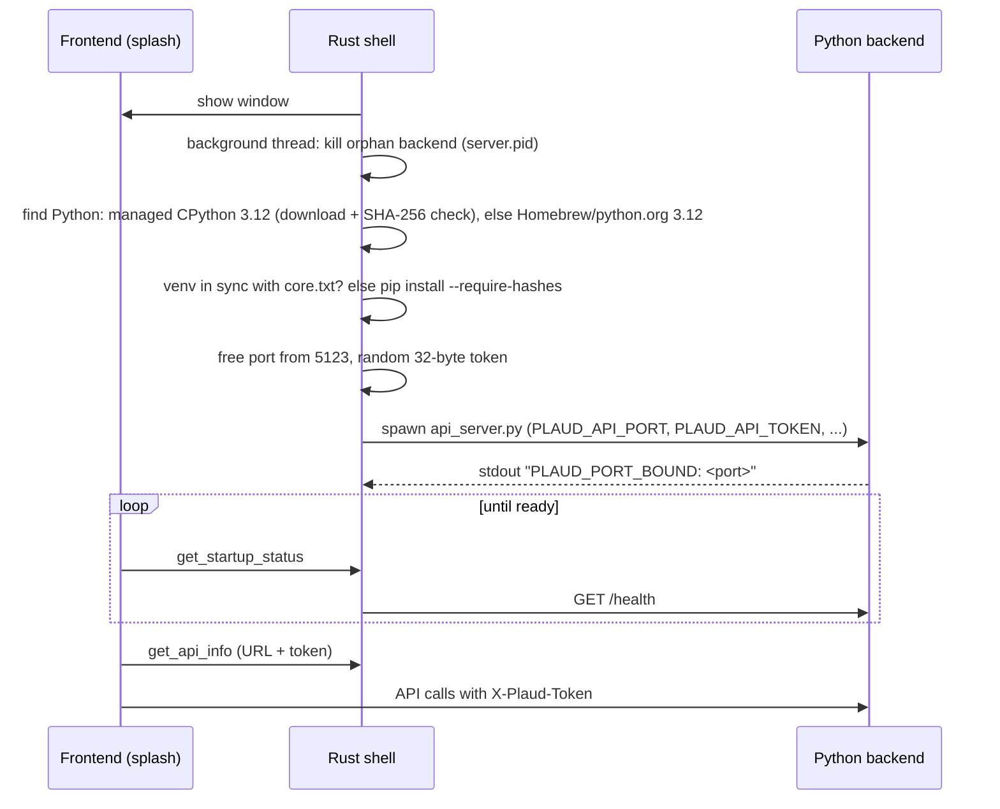
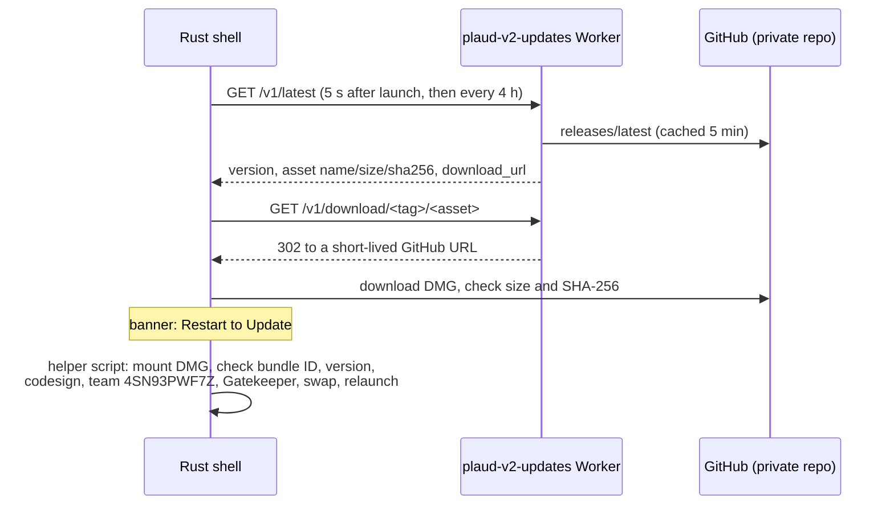

# Architecture

How Plaud V2 is put together, as of v2.4.0. For running and testing it see
[DEVELOPMENT.md](DEVELOPMENT.md); for shipping it see [RELEASING.md](RELEASING.md).

## Overview

Three parts in one macOS app bundle:

1. **Rust shell** (`src-tauri/`, Tauri 2.12). Owns the window, tray, dock icon, login item,
   sleep/wake detection, logging, the updater and the crash reporter. It sets up and supervises
   the Python backend.
2. **Python backend** (`app/` and `src/`, Flask). Does the real work: Bluetooth, WiFi sync,
   decryption, transcription, summaries, Notion, Google Drive, Plaud Cloud. Listens on
   `127.0.0.1`, from port 5123 up.
3. **Frontend** (`app/index.html`, `app/*.js`, `app/ui/*.js`, `app/css/`). Plain HTML, CSS and
   JavaScript in the system WebKit view, no framework or bundler. It calls the backend over HTTP
   and the shell through Tauri commands.

```
┌─────────────────────── Plaud V2.app ───────────────────────┐
│ Frontend (WKWebView, tauri://localhost)                    │
│   tauri-bridge.js → window.plaud.*                         │
│      │ invoke()/events                 │ fetch() + token   │
│      ▼                                 ▼                   │
│ Rust shell (src-tauri/src)        Python backend (Flask)   │
│   python.rs: runtime, venv,  ───► app/api_server.py        │
│   spawn, health, restarts         127.0.0.1:5123+          │
│   commands/: updater, reports                              │
└──────┬───────────────────────────────────┬─────────────────┘
       │ HTTPS                             │ BLE, WiFi hotspot, HTTPS
       ▼                                   ▼
 plaud-v2-updates Worker          NotePin S, AI providers, Notion,
 (infra/update-worker) → GitHub   Google Drive, Plaud API, webhooks
```

## Module map

### Rust shell (`src-tauri/src/`)

| File | Responsibility |
|---|---|
| `deep_link.rs` | Plaud sign-in links: the browser's "Continue to desktop" opens `plaud://login?auth_code=…` (scheme registered via `plugins.deep-link` in `tauri.conf.json`). The decoded code is held until the page takes it (`has_pending_sign_in_code`, `take_pending_sign_in_code`) after a `plaud-sign-in-link` event or at page load; `tauri-bridge.js` waits for the backend, then hands it to the `oauth-callback` listeners. The code is never logged. Any web page can open such a link, so the backend only exchanges a link's code while a sign-in started in the app in the last 15 minutes is pending, using that sign-in's id, which is cleared once used (`exchange_token(from_link=True)` in `app/state/cloud.py`) |
| `lib.rs` | Tauri builder: plugins (opener, single-instance, autostart, notification, dialog, deep-link), tray menu, themed dock icon and system-theme watcher, hide-on-close, the update-check loop, IPC command list, exit handling |
| `lifecycle.rs` | Starts the backend on a background thread; startup status for the splash (`get_startup_status`, `retry_startup`); shutdown (BLE disconnect, then SIGTERM/SIGKILL) once, off the main thread; SIGTERM/SIGINT handling; the panic hook |
| `python.rs` | Managed Python runtime and venv, lockfiles, port choice, per-launch API token, spawning `api_server.py`, `/health` polling, crash restarts (up to 3), orphan cleanup via a PID file |
| `power.rs` | Sleep/wake: `NSWorkspace` notifications, plus a wall-clock fallback; sends one `system-wake` event per wake |
| `paths.rs` | Where everything lives on disk: the data folder passed to Python as `PLAUD_DATA_DIR`, Application Support and log folders, and the separate dev-build folders |
| `logging.rs` | `~/Library/Logs/Plaud V2/app.log` (rotates at 1 MB, one old file kept). Backend stdout/stderr lands here too. `RUST_LOG` overrides levels |
| `commands/mod.rs` | IPC commands: API info, theme, login item, dock visibility, folder picker, notifications, the updater, the bug reporter and the diagnostics log |
| `commands/report_scrub.rs` | Removes secrets and personal data from bug reports |
| `commands/sha256.rs` | The shell's only SHA-256: update and Python-download checksums, the venv lockfile stamp, report IDs (no hashing crate in `Cargo.toml`) |

### Python backend

| Path | Responsibility |
|---|---|
| `app/api_server.py` | Flask app, request security (below), blueprint registration, startup housekeeping (partial files, WiFi recovery, Notion queue), port binding |
| `app/routes/` | HTTP endpoints, one blueprint per area: `core` (`/health`, `/audio`), `device` (`/device/*`: scan, connect, sync, WiFi sync, record, find-my, depair), `recordings` (list, tag, rename, crop, move, delete, re-download, transcripts), `transcribe` (`/transcribe`, `/summarize`, `/validate-key`), `notion` (`/notion/*`), `gdrive` (`/gdrive/*`), `cloud` (`/cloud/*`), `settings` |
| `app/state/` | Long-lived state and logic: `device.py` (BLE connection, handshake, encrypted command channel, file download, WiFi-sync orchestration), `notion.py` (Notion OAuth and MCP session), `gdrive.py` (Drive OAuth and uploads), `cloud.py` (Plaud account and cloud sync) |
| `app/providers/` | AI: `transcribe.py` (Deepgram, Groq, OpenAI), `summarize.py` (summary cascade), `validate.py` (API key checks), `_models.py` (every model ID in one place) |
| `app/utils/` | `config.py` (atomic, locked config), `constants.py` (paths, UUIDs, endpoints), `paths.py` (session-ID validation), `audio.py` (decryption, Ogg wrapping), `wifi_sync_worker.py` (WiFi sync subprocess), `notion_queue.py`, `trash.py`, `redownload_backup.py`, `transcript_locks.py`, `parent_watch.py`, `system.py` (on-demand pip installs, FFmpeg), `webhooks.py`, `recording_utils.py` |
| `app/requirements/` | Hash-pinned lockfiles: `core.txt` plus the `whisper`, `diarize` and `local-summary` extras. Generated by `scripts/lock-python-deps.sh` |
| `src/` | Older shared modules: `crypto.py` (RSA key loading and decryption for the handshake), `scanner.py` (BLE advertisement parsing), `transcribe.py` (local Whisper and diarization). `tauri.conf.json` bundles these files by name |

### Frontend

`index.html` loads plain scripts in this order: `tauri-bridge.js`, `ui/health-gate.js`,
`ui/utils.js`, `ui/recordings.js`, `ui/transcript.js`, `ui/settings.js`, `ui/setup.js`,
`renderer.js`. They share **one global scope**: two files can't declare the same top-level name
(v2.1.5 shipped a duplicate `const` and the whole UI failed to load).

| File | Responsibility |
|---|---|
| `tauri-bridge.js` | `window.plaud.*`: HTTP calls to the backend (with the token) and Tauri `invoke`/`listen`; error capture for the crash reporter, with a simplified copy of the Rust scrubbing rules |
| `ui/health-gate.js` | Startup splash: polls `get_startup_status`, shows progress, errors, **Retry** and the diagnostics log |
| `ui/utils.js` | Shared `app` state and `dom` references, formatters, toasts, Markdown rendering |
| `ui/recordings.js` | Recording list, search, multi-select, bulk actions, delete dialog |
| `ui/transcript.js` | Transcript and summary view, audio player, crop editor, tags |
| `ui/settings.js` | All settings tabs |
| `ui/setup.js` | First-run onboarding: Plaud sign-in, Bluetooth permission, scan, pair, profile |
| `renderer.js` | Start-up, sync buttons and progress, polling, WiFi-sync UI, wake handling, updates banner |

CSS lives in `app/css/` (`tokens.css` holds the design tokens; light and dark themes), imported
by `app/styles.css`.

## Startup

The window is shown first; Python is set up on a background thread while the splash shows
progress.



Details:

- **Runtime.** `python.rs` downloads a pinned python-build-standalone CPython **3.12.16**
  (`aarch64` only) into `~/Library/Application Support/com.plaud.v2/python/` and checks it against
  a SHA-256 compiled into the app. If that fails it accepts only a CPython 3.12 from Homebrew or
  python.org, because the lockfiles hold cp312 wheels. Intel Macs get a clear error.
- **Venv.** `~/Library/Application Support/com.plaud.v2/venv/`, built from `core.txt` (embedded in
  the binary and written to `.../com.plaud.v2/requirements/`). A stamp file records the
  lockfile's SHA-256, so a release that changes `core.txt` re-syncs the venv on next launch. Each
  launch also checks the core imports and repairs a damaged venv.
- **Extras** (`whisper`, `diarize`, `local-summary`) are installed on first use by
  `app/utils/system.py ensure_installed(..., extra=...)`, constrained by `core.txt`.
- **Readiness.** The backend has 30 s to answer `/health` (120 s right after a fresh download or
  venv sync). After that the splash shows a timeout, but polling continues and a late start still
  becomes ready.
- **Crashes.** The monitor restarts a crashed backend up to 3 times with the same port and token.
  `app/utils/parent_watch.py` makes Python exit if the shell dies.
- **Python startup** (`api_server.py __main__`): remove `*.partial` files, recover recording
  metadata, load the Plaud token, start the Notion queue worker, bind the port (trying up to 8),
  then run WiFi recovery in the background.
- **Shutdown.** Tray **Quit**, Cmd+Q, logout and SIGTERM all stop the backend once: BLE
  disconnect, then SIGTERM, then SIGKILL.

Environment variables passed to Python: `PLAUD_API_PORT`, `PLAUD_API_TOKEN`,
`PLAUD_REQUIREMENTS_DIR`, `PLAUD_PYTHON_RUNTIME`, `PLAUD_APP_VERSION` and `PLAUD_DATA_DIR` (the
data folder: the shell's own `PLAUD_DATA_DIR` if set, else `Plaud V2`, or `Plaud V2 (Dev)` in a
debug build; see Data locations).

## Security model

The backend listens on `127.0.0.1`, which any web page in any browser on the Mac can reach. Three
checks in `app/api_server.py` keep other pages and processes out:

1. **Per-launch token.** The shell generates 32 random bytes per launch and passes them to Python.
   Every request must send them in `X-Plaud-Token`. Only `GET /audio/...` (an `<audio src>` can't
   set headers) and `POST /device/disconnect` (sent with `sendBeacon` on reload) may use
   `?token=` instead. `/health` and CORS preflights are exempt.
2. **CORS.** Only `tauri://localhost`, `http://tauri.localhost` and `https://tauri.localhost` get
   CORS headers, so other origins can't read responses or send the token header.
3. **Host check.** Requests whose `Host` isn't `127.0.0.1` or `localhost` are refused, which
   blocks DNS rebinding.

Other rules:

- **Session IDs and paths** from requests are validated (`app/utils/paths.py`) and checked to stay
  inside the recordings folders before use. `/transcribe` only accepts files in those folders.
- **Deletes** go to the macOS Trash (`app/utils/trash.py`), or to `.trash/` in the data folder if
  that fails.
- **Re-download** moves the existing files to `.redownload_backup/<id>/` first and puts them back
  if the device no longer has the recording.
- **Config writes** are atomic, keep a `.bak` copy, are mode `0600`, and go through
  `update_config()` so concurrent writers don't lose each other's changes.
- **WiFi-sync credentials** (bind token, serial signature) go to the worker on stdin, not in
  `argv`, so `ps` can't see them.
- **No secrets in the app or repo.** The updater and crash reporter talk to a Cloudflare Worker
  that holds the GitHub token. See [SECURITY.md](../SECURITY.md).
- The webview CSP (`tauri.conf.json`) only allows connections to the app itself and `127.0.0.1`.

## Data locations

| Path | Contents |
|---|---|
| `~/Library/Application Support/Plaud V2/` | User data (the packaged app's `DATA_DIR`): `recordings/`, `transcripts/`, `sessions/`, `.plaud_v2_config.json` (settings, API keys, device tokens, recording metadata), `.plaud_config.json` (Plaud token), `.notion_mcp.json`, `.notion_queue.json`, `.gdrive_config.json`, `.hf_token` (optional), `wifi_restore.json`, `wifi_sync.lock`, `wifi_sync.log`, `.trash/`, `.redownload_backup/` |
| `~/Library/Application Support/com.plaud.v2/` | Shell-managed: `python/`, `venv/`, `requirements/`, `bin/ffmpeg`, `updates/`, `server.pid`, `tauri-prefs.json` (dock visibility), `diagnostics.log` |
| `~/Library/Logs/Plaud V2/` | `app.log`, `update.log` |
| `... Plaud V2 (Dev)/`, `com.plaud.v2.dev/`, `Logs/Plaud V2 (Dev)/` | The same, for debug builds (`tauri dev`). They share only `com.plaud.v2/python/` and `bin/` with the installed app |
| `~/.cache/whisper/`, `~/.cache/huggingface/`, `~/.wespeaker/` | Local Whisper, pyannote and DistilBART models, and the `diarize` package's WeSpeaker model (library defaults) |

`DATA_DIR` is chosen in `app/utils/constants.py`: `PLAUD_DATA_DIR` if set, else
`~/Library/Application Support/Plaud V2/`. The shell always sets `PLAUD_DATA_DIR`
(`src-tauri/src/paths.rs`): the variable it was started with, if any, else `Plaud V2`, or
`Plaud V2 (Dev)` for a debug build, and it reads the crash-report setting from the config in that
same folder. The repo is never used as the data folder. Users can also pick another
recordings folder; old folders stay listed.

## Device sync

The protocol is documented in [reverse-engineering/PROTOCOL.md](reverse-engineering/PROTOCOL.md) and
[reverse-engineering/COMMANDS.md](reverse-engineering/COMMANDS.md). In short:

### Bluetooth (`app/state/device.py`)

1. Scan with bleak and identify devices by the serial number in the manufacturer data (macOS
   randomises BLE addresses).
2. Send the serial-number signature, send the app's RSA public key, RSA-decrypt the device's
   reply to get the ChaCha20-Poly1305 session key, nonce and AAD, and check it decrypts
   `PLAUD.AI`.
3. Send the **BIND_TOKEN** handshake (cmd 1, twice: flag 0 then 1). The token is per device and
   comes from Plaud's API at pairing; the static APP_KEY from older notes doesn't work.
4. Sync time, read state, storage and battery, list files.
5. Download each new file. With the expected size and a clean end-of-file marker it's saved. A
   clean end with a different size is kept only if it decrypts. Anything else (stall, abort,
   disconnect, no end marker) is kept as `{id}_partial.bin` and retried next sync.
6. Decrypt (`app/utils/audio.py`): RSA-decrypt the per-file key, XOR each 80-byte Opus frame with
   a ChaCha20 keystream, check the result looks like Opus, wrap it in Ogg. A file that fails the
   check raises an error instead of saving noise.
7. Optionally delete the file from the device, only after an exact, clean download.

### WiFi (`app/utils/wifi_sync_worker.py`)

Used for large files (or on request). It runs as a separate process with its own BLE session,
because the device drops crypto sessions when BLE reconnects.

1. BLE handshake, then ask the device to open its hotspot.
2. Write a restore record (`wifi_restore.json`, fsynced) before changing any network setting.
3. Join the hotspot directly with CoreWLAN. Saved networks are left alone by default; they are
   paused only if macOS keeps auto-joining away, and only if each can be put back exactly.
4. The device connects to a WebSocket server the worker opens on the Mac; files are transferred
   encrypted with the BLE session keys.
5. Restore: rejoin the original network, re-add any paused networks in their original order,
   forget the hotspot. The record is deleted only after a verified restore.

A lock file (`wifi_sync.lock`) allows one worker at a time. If the app crashes mid-sync, the next
launch replays the restore record. A restore that keeps failing is given up after a few tries
(record moved to `wifi_restore.stuck.json`) and the UI says once which networks are missing.

## AI pipeline

### Transcription (`app/routes/transcribe.py`, `app/providers/transcribe.py`)

The provider chosen in Settings goes first, then the other cloud providers that have keys:

| Provider | Model | Notes |
|---|---|---|
| Deepgram | `nova-3` | Default. Speaker labels; custom vocabulary as keywords |
| Groq | `whisper-large-v3` | Vocabulary and profile as the prompt |
| OpenAI | `gpt-transcribe` | Text only, so segment times are estimated |
| Local | openai-whisper `base`/`small`/`medium`/`turbo`/`large` | Chosen in Settings, or used when no cloud provider works |

The result is saved as `transcripts/<id>.json` plus a `.txt`; spoken tags at the start of a
recording are detected and applied. Webhooks fire on `transcribe` (after the background speaker
labels, when those run).

Speaker labels follow the transcription provider; there's no separate setting beyond the
on/off toggle. Deepgram returns them with its transcript. For Groq, OpenAI or a Deepgram failure,
`_background_diarize` (`app/routes/transcribe.py`) labels the cloud transcript on the Mac after
the response; local Whisper does it inline. Local diarization (`src/transcribe.py`) tries:

1. The `diarize` package (Silero VAD + WeSpeaker ONNX, CPU). No token. The pinned `diarize` extra
   is installed on first use; a failed install isn't retried for 30 minutes. Its torchaudio 2.11
   needs torchcodec to decode audio, which the extra doesn't include, so `torchaudio.load` is
   routed through soundfile, and the audio is converted to 16 kHz mono WAV with FFmpeg first.
2. pyannote (`pyannote/speaker-diarization-3.1`), only if tier 1 couldn't run, a Hugging Face
   token is saved and pyannote.audio is already installed. The app never installs pyannote (it
   isn't in the lockfiles). The token is set in Settings › Processing › Speaker Identification:
   `POST /settings {hf_token}` checks it against `huggingface.co/api/whoami-v2`, then writes
   `.hf_token` (mode 0600). `GET /settings` returns only `hf_token_set`. The user must also accept
   the terms of `pyannote/speaker-diarization-3.1` and `pyannote/segmentation-3.0`.

The transcript JSON records `diarization_status` (`running`, `done`, `none` or `failed`) and a
`diarization_message`. The frontend polls `/transcripts` while it's `running` and shows the
message when it ends.

### Summaries (`app/providers/summarize.py`)

All model IDs are in `app/providers/_models.py`. The order is:

1. Anthropic `claude-sonnet-5-5` (or OpenRouter `anthropic/claude-sonnet-5.5` if there's no
   Anthropic key)
2. OpenAI `gpt-6.1-sol` (or OpenRouter `openai/gpt-6.1-sol` if there's no OpenAI key)
3. Ollama, if running locally, with the best model already pulled (`qwen3.8`, `qwen3.6`, `qwen3.5`, `gemma4`, ...; never a `-cloud` tag)
4. DistilBART (`sshleifer/distilbart-cnn-12-6`), installed on demand

The provider group chosen in Settings goes first. LLMs get the transcript as `[mm:ss] Speaker:
text` lines with the user's profile and tags as context, and return JSON with a summary and a
title (if a provider gives none, the first sentence of the summary is used). Webhooks fire on `summarize`, and
Notion auto-push runs if enabled.

## Notion (`app/state/notion.py`, `app/routes/notion.py`, `app/utils/notion_queue.py`)

- Uses Notion's **hosted MCP server** (`https://mcp.notion.com/mcp`, Streamable HTTP). There is no
  Notion API key: the app discovers the OAuth endpoints, registers itself as a client, and runs an
  OAuth flow with PKCE. The browser redirects to a one-shot callback server on `localhost:5124`.
- Each recording is one page, found by its **Session ID** property (upsert), so a push can be
  repeated safely.
- The app writes its content between a heading (`Plaud V2 — transcript & summary`) and an end
  marker, and only ever replaces that section. Tag and title changes update **properties only**.
- Schema changes only add: a `Session ID` column, a `Tags` multi-select, new tag options.
- Pushes go through a **durable queue** on disk (`.notion_queue.json`), retried with backoff,
  paused while Notion auth is broken, with failures listed in Settings with a Retry button.

Google Drive signs in with OAuth through a callback on `localhost:5125`, using the app's own
Google OAuth client (see [SECURITY.md](../SECURITY.md)), and uploads recordings to a chosen folder.

Both callback servers answer with the page in `app/utils/oauth_page.py` (connected, cancelled, out
of date, failed). It is self-contained: no outside fonts, images or scripts, a strict CSP with a
per-response nonce, `Referrer-Policy: no-referrer` and `no-store`, and its one script removes the
one-time code from the address bar.

## Updates and crash reports

The app has no GitHub token. It talks only to the `plaud-v2-updates` Cloudflare Worker
(`infra/update-worker/`), which holds the token as a secret.



Crash reports: Rust panics, renderer errors and Python tracebacks go through
`report_error`. The message is scrubbed (home folder, serials, BLE UUIDs, keys, tokens, e-mail
addresses, Notion/Drive links), fingerprinted, sent at most once per session, and posted to
`POST /v1/report`, which comments on the matching open `auto-bug` issue or opens one. Reports are
skipped when the user turned them off, for `AbortError`s, and while the backend is down; those
still go to `diagnostics.log`.

Release mechanics and the Worker's limits are in [RELEASING.md](RELEASING.md) and
[infra/update-worker/README.md](../infra/update-worker/README.md).

## Packaging

- `scripts/prepare-frontend.sh` (Tauri's `beforeBuildCommand`) copies the frontend into
  `dist-tauri/`, which Tauri serves.
- Bundle resources (`tauri.conf.json`): `src/`, `keys/` (the RSA keys from Plaud's app; gitignored),
  and the Python backend (`app/api_server.py`, `routes/`, `state/`, `providers/`, `utils/`). The
  lockfiles are compiled into the binary instead.
- FFmpeg isn't bundled: `app/utils/system.py` uses one on `PATH` or downloads it to
  `~/Library/Application Support/com.plaud.v2/bin/` on first use.
- Signed with Developer ID, hardened runtime, entitlements for Bluetooth, outgoing network and
  user-selected files (`src-tauri/Entitlements.plist`); notarised.
